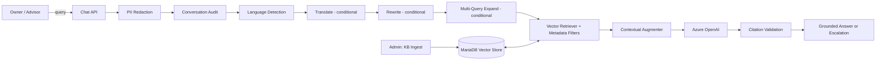

# AutoCare AI


A Retrieval-Augmented Generation (RAG) assistant for **vehicle service, maintenance and warranty guidance**, built with Spring Boot, Spring AI, Azure OpenAI and the MariaDB vector store.

AutoCare AI answers questions from vehicle owners and service advisors **only from an approved Knowledge Base (KB)**. Every policy answer cites its source documents. If no relevant KB content is found, the assistant escalates to a human advisor instead of guessing.

---

## Table of Contents

- [Key Features](#key-features)
- [Architecture](#architecture)
- [Tech Stack](#tech-stack)
- [Project Structure](#project-structure)
- [Prerequisites](#prerequisites)
- [Getting Started](#getting-started)
- [Configuration](#configuration)
- [Using the Application](#using-the-application)
- [API Reference](#api-reference)
- [Knowledge Base](#knowledge-base)
- [Testing](#testing)
- [Security & Privacy](#security--privacy)
- [Troubleshooting](#troubleshooting)
- [Documentation](#documentation)

---

## Key Features

- **Grounded answers only:** responses are generated from retrieved KB chunks and checked by a `CitationValidationAdvisor`. Unsupported policy claims are blocked.
- **Controlled escalation:** when no KB chunk passes the filters and the similarity threshold (≥ 0.50), the API returns a fixed escalation response instead of a generated guess.
- **Role-aware retrieval:** separate `OWNER`, `ADVISOR` and `ADMIN` roles. Metadata filters (audience, vehicle family, status, version) keep restricted content from reaching other roles.
- **PII redaction:** VINs, registration numbers, phone numbers, emails, customer IDs and addresses are redacted before any logging or LLM call.
- **Modular RAG pipeline:** conditional query translation, rewrite and multi-query expansion, run before vector retrieval.
- **Multi-ChatClient routing:** one `ChatClient` handles query transformation and a separate one generates answers, with every stage traced in the logs.
- **Full audit trail:** each turn gets one append-only, redacted audit record with its correlation ID, transformations, sources and citation status.
- **KB version management:** ingest, validate, activate and roll back KB document versions.
- **Sync and streaming chat:** standard JSON responses and Server-Sent Events (SSE) streaming.
- **Web UI:** a chat assistant page and an admin page for KB management.

## Architecture



See [architecture.md](architecture.md) for the full design.

## Tech Stack

| Layer | Technology |
|---|---|
| Language | Java 21 |
| Framework | Spring Boot 3.3.5, Spring Security, Spring Data JPA |
| AI | Spring AI 1.0.0 (advisors, modular RAG) |
| LLM / Embeddings | Azure OpenAI (chat deployment + `text-embedding-ada-002`, 1536 dimensions) |
| Vector Store / DB | MariaDB 11.8+ (native `VECTOR` type) |
| Migrations | Flyway |
| API Docs | springdoc-openapi (Swagger UI) |
| Frontend | HTML, CSS, vanilla JavaScript |
| Testing | JUnit 5, Mockito, H2, JaCoCo (≥ 80% line coverage on services) |
| Build | Maven |

## Project Structure

```
.
├── autocare-ai/                 # Spring Boot backend (Maven project)
│   ├── pom.xml
│   └── src/
│       ├── main/java/com/autocare/ai/
│       │   ├── advisor/         # Redaction, audit, citation, safeguard advisors
│       │   ├── audit/           # Conversation audit entities & repository
│       │   ├── config/          # ChatClient, RAG, vector store, security config
│       │   ├── controller/      # Chat, KB ingest, KB management, monitoring APIs
│       │   ├── exception/       # Global error handling
│       │   ├── model/           # DTOs and enums
│       │   ├── retrieval/       # Retriever, metadata filters, KB chunk store
│       │   ├── security/        # Rate limiting, request logging, chat memory
│       │   ├── service/         # Chat, ingestion, versioning, language detection
│       │   └── transform/       # Translate / rewrite / expand query transformers
│       └── main/resources/
│           ├── application.yml
│           ├── db/migration/    # Flyway SQL migrations
│           ├── prompts/         # Prompt templates (.st)
│           └── static/          # Admin UI
├── frontend/                    # Chat UI (bundled into the jar at build time)
├── KB/                          # Knowledge Base documents (KB-AUTO-001 … 008) + metadata
├── architecture.md              # System architecture
├── plan.md                      # Implementation plan
├── tasks.md                     # Task breakdown
├── testing.md                   # Test strategy & plan
└── AutoCareAI_SRS.docx          # Software Requirements Specification
```

## Prerequisites

| Requirement | Version / Notes |
|---|---|
| JDK | **21** (recommended). Newer JDKs need extra build flags; see [Troubleshooting](#troubleshooting). |
| Maven | 3.9+ |
| MariaDB | **11.8+** (native vector support starts in 11.7). MySQL is **not** supported. |
| Azure OpenAI | A resource with one chat deployment and one embedding deployment |

## Getting Started

### 1. Clone the repository

```bash
git clone https://github.com/<your-username>/<your-repo>.git
cd <your-repo>
```

### 2. Create the database

```sql
CREATE DATABASE autocare_ai CHARACTER SET utf8mb4 COLLATE utf8mb4_unicode_ci;
CREATE USER 'autocare'@'localhost' IDENTIFIED BY '<choose-a-password>';
GRANT ALL PRIVILEGES ON autocare_ai.* TO 'autocare'@'localhost';
FLUSH PRIVILEGES;
```

Flyway creates the application tables on first start. Spring AI creates the vector table.

### 3. Set environment variables

macOS / Linux:

```bash
export AZURE_OPENAI_ENDPOINT="https://<your-resource>.openai.azure.com/"
export AZURE_OPENAI_KEY="<your-azure-openai-key>"
export DB_PASSWORD="<your-db-password>"
```

Windows (PowerShell):

```powershell
$env:AZURE_OPENAI_ENDPOINT="https://<your-resource>.openai.azure.com/"
$env:AZURE_OPENAI_KEY="<your-azure-openai-key>"
$env:DB_PASSWORD="<your-db-password>"
```

### 4. Build and run

```bash
cd autocare-ai
mvn clean package -DskipTests
mvn spring-boot:run
```

The application starts on **http://localhost:8080**.

## Configuration

The main settings are in [`autocare-ai/src/main/resources/application.yml`](autocare-ai/src/main/resources/application.yml).

| Property | Default | Description |
|---|---|---|
| `spring.datasource.url` | `jdbc:mariadb://localhost:3306/autocare_ai` | MariaDB connection |
| `spring.ai.azure.openai.chat.options.deployment-name` | `gpt-5-1` | Azure chat deployment name |
| `spring.ai.azure.openai.embedding.options.deployment-name` | `text-embedding-ada-002` | Azure embedding deployment name |
| `autocare.chat.query-transform-deployment` | `gpt-5-1` | Deployment used for translate/rewrite/expand |
| `autocare.chat.answer-deployment` | `gpt-5-1` | Deployment used for final answers |
| `autocare.rag.similarity-threshold` | `0.50` | Minimum similarity for a chunk to count as evidence |
| `autocare.rag.allow-empty-context` | `false` | Must stay `false` to keep controlled escalation |
| `autocare.embedding.dimension` | `1536` | Must match the embedding model's output size |
| `autocare.rate-limit.chat-requests-per-minute` | `10` | Per-user chat rate limit |

> Change the deployment names to match the deployments in your Azure OpenAI resource.

Local-only overrides can go in `application-local.yml`, which is git-ignored.

## Using the Application

| Page | URL |
|---|---|
| Chat assistant | http://localhost:8080/ |
| KB admin console | http://localhost:8080/admin.html |
| Swagger UI | http://localhost:8080/swagger-ui.html |

### Demo accounts (HTTP Basic Auth)

| Username | Default password | Role | Override property |
|---|---|---|---|
| `owner` | `owner-pass` | Vehicle Owner | `autocare.security.test-users.owner-password` |
| `advisor` | `advisor-pass` | Service Advisor | `autocare.security.test-users.advisor-password` |
| `admin` | `admin-pass` | KB Admin | `autocare.security.test-users.admin-password` |

> These are local development defaults. **Change them before any shared deployment.**

## API Reference

| Method | Endpoint | Role | Description |
|---|---|---|---|
| POST | `/ai/autocare/chat/sync` | OWNER, ADVISOR | Grounded chat, JSON response |
| POST | `/ai/autocare/chat/stream` | OWNER, ADVISOR | Grounded chat, SSE stream |
| POST | `/kb/ingest` | ADMIN | Ingest a KB document section (as `RETIRED` until activated) |
| GET | `/kb/documents` | ADMIN | List KB documents and versions |
| POST | `/kb/documents/{docCode}/versions/{version}/validate` | ADMIN | Run validation questions against a version |
| POST | `/kb/documents/{docCode}/versions/{version}/activate` | ADMIN | Activate a validated version |
| POST | `/kb/documents/{docCode}/rollback` | ADMIN | Roll back to the previous version |
| GET | `/ai/autocare/monitoring` | ADMIN | Audit / monitoring overview |
| GET | `/ai/autocare/monitoring/{correlationId}` | ADMIN | Trace a single conversation turn |

### Example: chat request

```bash
curl -u owner:owner-pass -X POST http://localhost:8080/ai/autocare/chat/sync \
  -H "Content-Type: application/json" \
  -d '{
        "sessionId": "demo-session-1",
        "role": "OWNER",
        "vehicleFamily": "all",
        "query": "When is my next scheduled maintenance service due?",
        "language": "en"
      }'
```

The `role` in the request body must match the authenticated user's role. Otherwise the API returns `403`.

### Escalation response (no matching KB content)

```json
{
  "answer": "No matching vehicle service or warranty information was found in the AutoCare Knowledge Base. Please contact an authorized service advisor.",
  "escalated": true,
  "sources": []
}
```

## Knowledge Base

The `KB/` folder holds eight documents:

| Code | Topic |
|---|---|
| KB-AUTO-001 | Vehicle Families and Maintenance Categories |
| KB-AUTO-002 | Preventive Maintenance and Service Schedule |
| KB-AUTO-003 | Warranty Coverage, Eligibility and Exclusions |
| KB-AUTO-004 | Service Booking, Workshop Visit and Packages |
| KB-AUTO-005 | Vehicle Symptoms and Safe Next Actions |
| KB-AUTO-006 | Repair Status, Claims and Roadside Assistance |
| KB-AUTO-007 | Service Advisor Operations, Inspection and SLA *(advisor-only)* |
| KB-AUTO-008 | Complaints, Warranty Disputes and KB Administration |

The per-document metadata (audience, vehicle family, version, status) is in [KB/KB-METADATA.md](KB/KB-METADATA.md).

**KB lifecycle:** ingest (as `RETIRED`) → validate with test questions → activate → the superseded version is retired automatically. Rollback is available.

## Testing

```bash
cd autocare-ai

# Unit tests (H2 in-memory DB, mocked AI; no MariaDB or Azure needed)
mvn test

# Full verification: integration tests + JaCoCo coverage gate (≥ 80% on services)
mvn verify
```

The coverage report is written to `autocare-ai/target/site/jacoco/index.html`.

See [testing.md](testing.md) for the full test plan.

## Security & Privacy

- **Authentication:** HTTP Basic, stateless sessions, BCrypt-hashed passwords.
- **Authorization:** `/kb/**` and `/ai/autocare/monitoring/**` are restricted to ADMIN. Chat requires an authenticated role.
- **Redaction mapping:** VIN → `[VIN-REDACTED]`, registration → `[REG-NO-REDACTED]`, customer ID → `[CUSTOMER-ID-REDACTED]`, phone → `[PHONE-REDACTED]`, email → `[EMAIL-REDACTED]`, address → `[ADDRESS-REDACTED]`.
- **Rate limiting:** per-user limits on chat and KB endpoints.
- **Secrets:** Azure keys and DB passwords come from environment variables. Never commit real credentials.

## Troubleshooting

| Problem | Cause / Fix |
|---|---|
| `cannot find symbol` errors on getters/builders | Lombok isn't running. Use **JDK 21**. On JDK 23+, javac no longer runs annotation processors by default. To build on a newer JDK, run `mvn compile -Dlombok.version=1.18.44 -Dmaven.compiler.proc=full`. |
| Many Mockito errors when running tests on JDK 24+ | The Mockito/Byte Buddy versions bundled with Spring Boot 3.3.5 don't support very new JDKs. Run tests with **JDK 21**. |
| `Access denied for user 'autocare'@'localhost'` | The database user doesn't exist or the password doesn't match `DB_PASSWORD`. Repeat step 2 of [Getting Started](#getting-started). |
| Vector table / `VECTOR` type errors | You're running MySQL or an old MariaDB. Install **MariaDB 11.8+**. |
| Startup fails on `AZURE_OPENAI_ENDPOINT` | Set the Azure environment variables before starting the app. |
| `DeploymentNotFound` from Azure | The deployment names in `application.yml` don't match your Azure resource. |

## Documentation

| Document | Contents |
|---|---|
| [architecture.md](architecture.md) | Components, advisor chain, RAG flow, data model |
| [plan.md](plan.md) | Implementation phases |
| [tasks.md](tasks.md) | Detailed task list |
| [testing.md](testing.md) | Test strategy and acceptance gates |
| [KB/KB-METADATA.md](KB/KB-METADATA.md) | Knowledge Base metadata |
| `AutoCareAI_SRS.docx` | Software Requirements Specification |
