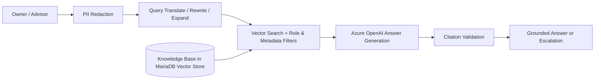

# AutoCare AI

**An AI assistant for vehicle service, maintenance and warranty questions. It answers only from an approved knowledge base.**

---

## Overview

AutoCare AI is a Retrieval-Augmented Generation (RAG) assistant built with **Spring Boot**, **Spring AI**, **Azure OpenAI** and the **MariaDB vector store**. It helps **vehicle owners** and **service advisors** get accurate answers about service schedules, preventive maintenance, warranty coverage, workshop bookings, vehicle symptoms, repair status and roadside assistance.

General-purpose chatbots can invent service intervals, warranty terms or prices. AutoCare AI generates every answer from retrieved Knowledge Base content and cites its sources. When the Knowledge Base has no relevant information, the assistant does not guess. It escalates the user to an authorized service advisor.

## Problem It Solves

- Customers often get inconsistent or wrong answers about maintenance and warranty policies.
- Service advisors spend time on repetitive questions that the official documentation already answers.
- Ungrounded AI answers can cause financial and safety risks, such as wrong warranty claims or unsafe driving advice.

AutoCare AI answers these questions with policy-compliant, cited and auditable responses. It also protects customer privacy.

## Core Principles

| Principle | What it means |
|---|---|
| **Grounded answers only** | Every policy answer comes from Knowledge Base content and is checked for valid citations. |
| **Controlled escalation** | When no relevant content is found, the assistant returns a fixed escalation message and never a guess. |
| **Role-aware access** | Owners, advisors and admins each see only the content intended for their role. |
| **Privacy by design** | VINs, registration numbers, phone numbers, emails, customer IDs and addresses are redacted before any logging or AI processing. |
| **Full traceability** | Every conversation turn is recorded in a redacted, append-only audit trail. |

## Key Features

- **Modular RAG pipeline:** conditional query translation, follow-up rewriting and multi-query expansion, followed by vector search with metadata filters.
- **Citation validation:** answers that make unsupported policy claims are blocked before they reach the user.
- **Multi-model routing:** one AI client handles query transformation and a separate client generates the final answer. Every stage is logged and traceable.
- **Domain safeguards:** safety-critical symptoms such as brake failure, smoke or overheating produce stop-driving and seek-assistance guidance. Warranty answers are framed as preliminary guidance, never as final decisions.
- **Knowledge Base versioning:** admins ingest, validate, activate and roll back document versions. Only validated, active content is used in answers.
- **Real-time responses:** supports both standard and streaming chat responses.
- **Monitoring and audit:** admins can trace any conversation turn by its correlation ID.
- **Web interface:** a chat assistant for owners and advisors, and an admin console for managing the Knowledge Base.

## How It Works

## Users and Roles

| Role | Access |
|---|---|
| **Vehicle Owner** | Maintenance, warranty, booking, symptom and repair-status guidance |
| **Service Advisor** | Everything owners see, plus advisor-only operations, inspection and SLA content |
| **KB Admin** | Knowledge Base ingestion, validation, version control and conversation monitoring |

## Knowledge Base Coverage

The assistant draws on eight Knowledge Base documents:

1. Vehicle Families and Maintenance Categories
2. Preventive Maintenance and Service Schedule
3. Warranty Coverage, Eligibility and Exclusions
4. Service Booking, Workshop Visit and Packages
5. Vehicle Symptoms and Safe Next Actions
6. Repair Status, Claims and Roadside Assistance
7. Service Advisor Operations, Inspection and SLA *(advisor-only)*
8. Complaints, Warranty Disputes and KB Administration

## Technology Stack

| Layer | Technology |
|---|---|
| Backend | Java 21, Spring Boot 3.3.5 |
| AI Framework | Spring AI 1.0.0 (advisor chain, modular RAG) |
| Language Model | Azure OpenAI |
| Vector Store and Database | MariaDB with native vector support |
| Security | Spring Security, role-based access, PII redaction, rate limiting |
| Database Migrations | Flyway |
| API Documentation | OpenAPI / Swagger UI |
| Frontend | HTML, CSS, JavaScript |
| Testing | JUnit 5, Mockito, JaCoCo |
