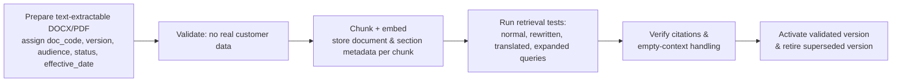

# AutoCare AI — System Architecture

Source: `AutoCareAI_SRS.docx` (v1.0) and `KB/KB-METADATA.md`. AutoCare AI is a Spring AI, Retrieval-Augmented Generation (RAG) assistant for vehicle service, maintenance and warranty guidance, serving Vehicle Owners, Service Advisors and KB Admins.

## 1. Architectural Goals

- **Grounded answers only**: no service interval, warranty term, price, SLA or claim decision may be invented; every policy answer must cite retrieved AutoCare KB content (FR-013, NFR-001).
- **Role-aware retrieval**: owner-, advisor- and admin-only content must never leak across roles (FR-024, NFR-002).
- **Privacy by design**: VIN, registration number, phone, email, customer ID and address are redacted before logging or LLM processing (NFR-003, §4.6).
- **Full traceability**: every turn is auditable by session, transformation and retrieved source (NFR-004).
- **Controlled failure**: no relevant KB context ⇒ fixed escalation fallback, never a generated guess (FR-014, §4.2).

## 2. High-Level Component Diagram

```mermaid
flowchart LR
    U[Vehicle Owner / Service Advisor] -->|query| API[Chat API\nPOST /ai/autocare/chat/sync, /stream]
    API --> RED[PiiVehicleRedactionAdvisor]
    RED --> AUD[ConversationAuditAdvisor]
    AUD --> LOG[SimpleLoggerAdvisor]
    LOG --> LANG[Language Detection]
    LANG --> TQT[TranslationQueryTransformer\nconditional]
    TQT --> RQT[RewriteQueryTransformer\nconditional]
    RQT --> MQE[MultiQueryExpander\nconditional]
    MQE --> RET[VectorStoreDocumentRetriever\n+ metadata filters]
    RET --> CQA[ContextualQueryAugmenter\nallowEmptyContext=false]
    CQA --> LLM[ChatClient / ChatModel\nAzure OpenAI GPT-4+]
    LLM --> CVA[CitationValidationAdvisor]
    CVA --> RESP[Grounded Response\nor Controlled Escalation]

    VS[(MariaDB 11.8+\nVector Store)] <--> RET
    KBADMIN[Admin: KB Ingestion\nPOST /kb/ingest] --> VS
    AUD --> AUDITDB[(Audit Log Store\nredacted, append-only)]
```



This mirrors the modular RAG pipeline defined in SRS §2.1:
`Query → PII/Vehicle-Identifier Redaction → ConversationAuditAdvisor → SimpleLoggerAdvisor → Language Detection → TranslationQueryTransformer (conditional) → RewriteQueryTransformer (conditional) → MultiQueryExpander (conditional) → VectorStoreDocumentRetriever (metadata filters) → ContextualQueryAugmenter → LLM → CitationValidationAdvisor → Grounded Response or Controlled Escalation.`

## 3. Technology Stack (SRS §2.3)

| Layer | Technology / Notes |
|---|---|
| Backend | Spring Boot 3.x, Java 21+ |
| AI Framework | Spring AI — advisor chain and modular RAG |
| LLM | Azure OpenAI (GPT-4+) |
| Embedding Model | Configured embedding deployment; dimensions must match the vector column |
| Vector Store | MariaDB 11.8+ with vector capability, cosine-similarity retrieval |
| API Documentation | Springdoc OpenAPI / Swagger UI |
| Logging | `SimpleLoggerAdvisor` (framework diagnostics) + `ConversationAuditAdvisor` (persistent, redacted audit) |
| Security | Role-based access, PII redaction, metadata filters, audit trail |
| Multi-Model Demo | ≥ 2 distinct `ChatModel` instances via separate `ChatClient` configurations with explicit routing and traceable logs (§4.7, mandatory) |

## 4. Advisor Chain / Modular RAG Responsibilities (SRS §2.4)

| Component | Responsibility | Mandatory Control |
|---|---|---|
| `PiiVehicleRedactionAdvisor` | Redacts personal/vehicle identifiers before model processing and logging | Raw VIN, registration, phone, email, customer ID must never enter the audit log |
| `ConversationAuditAdvisor` | Persists the full redacted conversation trail (session ID, timestamp, actor, transformations, retrieved sources, response status) | One append-only audit record per turn |
| `SimpleLoggerAdvisor` | Framework-level request/response diagnostics | Not the persistent business conversation store |
| `TranslationQueryTransformer` | Translates queries when user language ≠ KB retrieval language | Preserve identifiers, model names, units, numbers |
| `RewriteQueryTransformer` | Converts unclear/dependent follow-ups into standalone retrieval queries | Preserve intent; must not add symptoms or vehicle facts |
| `MultiQueryExpander` | Generates related retrieval formulations for broad/ambiguous queries | Retrieval aid only, not a diagnosis |
| `VectorStoreDocumentRetriever` | Retrieves candidate KB chunks via similarity + metadata filters | Filter by audience, vehicle family, status, effective version |
| `ContextualQueryAugmenter` | Adds retrieved context + grounding instructions to the model request | Empty context must not produce a policy answer (`allowEmptyContext=false`) |
| `RetrievalAugmentationAdvisor` | Coordinates transformers, expander, retriever and augmenter | Drives the modular RAG flow |
| `CitationValidationAdvisor` | Validates that answer statements reference retrieved KB sources | Unsupported policy claims are blocked |

## 5. Retrieval & Metadata Filtering

Retrieval is gated by metadata carried on every KB chunk (`doc_code`, `version`, `status`, `audience`, `vehicle_family`) — see `KB/KB-METADATA.md` for the full per-document table. Filter order applied before a chunk is eligible as evidence:

1. **status = active** — superseded/retired versions are excluded from live retrieval (kept for audit only).
2. **version** — only the currently effective version per `doc_code` participates.
3. **audience** — matches the caller's role (`owner`, `advisor`, `admin`); KB-AUTO-007 is advisor-only, KB-AUTO-008 has section-level audience splits.
4. **vehicle_family** — vehicle-specific answers require a matching family; otherwise only `vehicle_family=all` general guidance is retrieved.
5. **similarity threshold ≥ 0.50** — chunks scoring below this are not supplied as evidence.

If no chunk passes all filters, the system returns the fixed empty-context response (§4.2):
```json
{ "answer": "No matching vehicle service or warranty information was found in the AutoCare Knowledge Base. Please contact an authorized service advisor.", "escalated": true, "sources": [] }
```

## 6. Role-Based Access Model

| Role | Retrieval Scope | Cannot |
|---|---|---|
| Vehicle Owner | KB-AUTO-001–006 + owner-tagged sections of KB-AUTO-008 | KB-AUTO-007 (advisor-only); admin-only sections of KB-AUTO-008 |
| Service Advisor | All owner content + KB-AUTO-007 | Admin-only ingestion/audit/version-control sections of KB-AUTO-008 |
| Admin | All 8 documents including advisor- and admin-only sections | Make warranty decisions; alter a written audit record |

## 7. Data & Logging Architecture

- **Vector Store (MariaDB)**: embeddings + chunk metadata (`doc_code`, `version`, `status`, `audience`, `vehicle_family`, section) for similarity search and filtering.
- **Conversation Audit Store**: append-only, redacted records per turn — session ID (UUID), timestamp, actor, redacted query, applied transformations, retrieved document codes, final response, citation status, escalation status (§4.3).
- **Redaction Mapping** (§4.6): VIN → `[VIN-REDACTED]`, registration → `[REG-NO-REDACTED]`, customer ID → `[CUSTOMER-ID-REDACTED]`, phone → `[PHONE-REDACTED]`, email → `[EMAIL-REDACTED]`, address → `[ADDRESS-REDACTED]`. Applied by `PiiVehicleRedactionAdvisor` before any logging or model call.
- **Diagnostic logs** (`SimpleLoggerAdvisor`) include correlation ID and response status, excluding raw sensitive identifiers (NFR-009).

## 8. API Surface (SRS §6)

| Method | Endpoint | Description |
|---|---|---|
| POST | `/ai/autocare/chat/sync` | Synchronous grounded chat |
| POST | `/ai/autocare/chat/stream` | Streaming grounded chat |
| POST | `/kb/ingest` | Ingest KB document + metadata (Admin only) |

## 9. KB Governance / Ingestion Flow (KB-AUTO-008 §4)



## 10. Domain Safeguards

- Safety-critical symptoms (brake failure, smoke, fuel smell, overheating) return stop-driving/seek-assistance guidance only when present in retrieved KB content (§4.5, KB-AUTO-005).
- Warranty responses are preliminary pre-check guidance, never a final approval/rejection (KB-AUTO-003 §5).
- No unsupported repair cost or completion date is ever generated.
- Vehicle-specific instructions require matching `vehicle_family` metadata; otherwise the system asks for context or escalates.

## 11. Non-Functional Requirements Mapping (SRS §5)

| NFR | Architectural Mechanism |
|---|---|
| NFR-001 Grounding | `CitationValidationAdvisor` + mandatory citation in every policy answer |
| NFR-002 Security | `audience` metadata filter in `VectorStoreDocumentRetriever` |
| NFR-003 Privacy | `PiiVehicleRedactionAdvisor` before logging/model call |
| NFR-004 Auditability | `ConversationAuditAdvisor` per-turn append-only record |
| NFR-005 Availability | Controlled error body when dependent services are unavailable |
| NFR-006 Performance | Response-time objective defined/tested per deployment environment |
| NFR-007 Maintainability | Advisors and RAG modules independently configurable |
| NFR-008 Versioning | `doc_code`, `version`, `status`, `effective_date` on every chunk |
| NFR-009 Observability | Correlation ID + response status in logs, no raw sensitive identifiers |
| NFR-010 Quality | Admin validates retrieval with test questions before activating a KB version (see `KB/KB-METADATA.md` §6) |

## 12. Multi-ChatClient Configuration (SRS §4.7 Mandatory)

SRS §4.7 requires at least two distinct `ChatModel` instances behind separate `ChatClient` configurations, each with a clearly defined responsibility, explicit model selection/routing, and traceable logs of which `ChatClient`/`ChatModel` handled each stage.

| ChatClient | Backing ChatModel | Responsibility | Invoked By | Traceability |
|---|---|---|---|---|
| **`QueryTransformChatClient`** | Smaller/faster Azure OpenAI deployment (low-latency, low-cost) | Query-side transformations only: language translation, follow-up rewrite, multi-query expansion. Never generates a user-facing policy answer. | `TranslationQueryTransformer`, `RewriteQueryTransformer`, `MultiQueryExpander` | Each invocation logs `chatClient=QueryTransformChatClient`, `chatModel=<deployment-name>`, `stage=TRANSLATE\|REWRITE\|EXPAND`, correlation ID |
| **`AnswerChatClient`** | Primary Azure OpenAI GPT-4+ deployment | Final grounded-answer generation over the augmented RAG context; the only client allowed to produce the response returned to the user. | `RetrievalAugmentationAdvisor` → `ContextualQueryAugmenter` → LLM call stage | Each invocation logs `chatClient=AnswerChatClient`, `chatModel=<deployment-name>`, `stage=ANSWER_GENERATION`, correlation ID |

Routing rule: the advisor chain always routes query-transformation stages to `QueryTransformChatClient` and the single final generation stage to `AnswerChatClient`; routing is explicit (no dynamic/implicit model selection), satisfying the "explicit model selection or routing" requirement in §4.7.

## 13. Package and Class Structure (`com.autocare.ai`)

```
com.autocare.ai
├── AutoCareAiApplication.java                 # Spring Boot entry point

├── config
│   ├── ChatClientConfig.java                  # Registers QueryTransformChatClient and AnswerChatClient beans
│   ├── VectorStoreConfig.java                 # MariaDB vector store + embedding model configuration
│   ├── RetrievalAugmentationConfig.java       # Wires RetrievalAugmentationAdvisor, transformers, expander, augmenter
│   └── SecurityConfig.java                    # Role-based access, auth filter chain

├── controller
│   ├── ChatController.java                    # POST /ai/autocare/chat/sync, /ai/autocare/chat/stream
│   └── KbIngestController.java                # POST /kb/ingest (Admin only)

├── advisor
│   ├── PiiVehicleRedactionAdvisor.java
│   ├── ConversationAuditAdvisor.java
│   ├── SimpleLoggerAdvisorConfig.java          # Enables/configures built-in SimpleLoggerAdvisor
│   └── CitationValidationAdvisor.java

├── transform
│   ├── TranslationQueryTransformerConfig.java
│   ├── RewriteQueryTransformerConfig.java
│   └── MultiQueryExpanderConfig.java

├── retrieval
│   ├── VectorStoreDocumentRetrieverConfig.java # Similarity threshold + metadata filter builder
│   ├── MetadataFilterBuilder.java              # Builds audience/status/version/vehicle_family filters from UserRole
│   └── ContextualQueryAugmenterConfig.java     # allowEmptyContext=false, grounding instructions

├── service
│   ├── ChatService.java                        # Orchestrates the end-to-end advisor/RAG pipeline for a turn
│   ├── KbIngestionService.java                 # Chunk, embed, tag metadata, activate/retire versions
│   └── LanguageDetectionService.java

├── model
│   ├── dto
│   │   ├── ChatRequest.java
│   │   ├── ChatResponse.java
│   │   ├── ErrorResponse.java
│   │   ├── SourceCitation.java
│   │   └── KbIngestRequest.java
│   └── enums
│       ├── UserRole.java                       # OWNER, ADVISOR, ADMIN
│       ├── DocStatus.java                      # ACTIVE, SUPERSEDED, RETIRED
│       └── EscalationStatus.java

├── audit
│   ├── ConversationAuditRecord.java             # JPA entity mapped to the audit table (Section 16)
│   └── ConversationAuditRepository.java

├── security
│   ├── RoleContext.java                         # Resolves authenticated UserRole for the current request
│   └── RedactionPatterns.java                   # VIN/registration/phone/email/address regex + token map

└── exception
    ├── GlobalExceptionHandler.java              # Maps exceptions to ErrorResponse (Section 15)
    └── NoMatchingContextException.java          # Raised when allowEmptyContext would be violated
```

## 14. When Query Transformers Run

Each transformer is conditional and only one path (or none) applies per query, evaluated in the order below immediately after Language Detection:

| Transformer | Trigger Condition | Does Not Run When |
|---|---|---|
| `TranslationQueryTransformer` | Language Detection determines the user's query language differs from the KB retrieval language | Query language already matches the KB retrieval language |
| `RewriteQueryTransformer` | The query is an unclear or conversationally dependent follow-up (e.g., pronouns, missing subject, references prior turns) that cannot be used as a standalone retrieval query | The query is already a complete, standalone retrieval query |
| `MultiQueryExpander` | The query is broad or ambiguous and a single retrieval formulation is unlikely to cover the relevant KB chunks (e.g., "car vibrating") | The query is specific and a single retrieval formulation is already sufficient |

Rules that apply across all three (SRS §4.4):
- They execute in this fixed order: Translate → Rewrite → Expand, each operating on the output of the previous stage.
- The retrieval language is configured with `autocare.rag.retrieval-language` (default `en`); translation is skipped when the detected query language matches it or is undetermined.
- Translation uses `QueryTransformChatClient` and preserves vehicle identifiers, model names, acronyms, numeric values, dates, measurements and units.
- `RewriteQueryTransformer` runs only when conversation history is available and the follow-up contains a contextual reference; it must preserve original intent and must not add symptoms or vehicle facts.
- `MultiQueryExpander` runs for short, broad/ambiguous phrases (for example, `car vibrating`, `strange noise` or `vehicle issue`) and retains the original query with three retrieval variants; specific standalone queries are not expanded.
- The multi-query prompt must not introduce new symptoms, component failures or entitlement assumptions.
- The original query and every transformed/expanded variant are linked together in the `ConversationAuditAdvisor` record (Section 16) for traceability.

## 15. Chat Request / Response / Error JSON Contracts

### 15.1 Chat Request — `POST /ai/autocare/chat/sync` / `/ai/autocare/chat/stream`

```json
{
  "sessionId": "b6b6b6c2-8a2b-4e9b-9a3d-6b8c2f6e1a10",
  "role": "ADVISOR",
  "vehicleFamily": "AC-SV-D",
  "query": "What is the SLA for warranty evidence review?",
  "language": "en"
}
```

| Field | Type | Required | Notes |
|---|---|---|---|
| `sessionId` | UUID string | Yes | One UUID per conversation session (NFR §4.3); generated client-side or by the API on first turn |
| `role` | enum: `OWNER` \| `ADVISOR` \| `ADMIN` | Yes | **How role is transmitted**: sent as an explicit field in the request body, but the API never trusts the client-supplied value alone — `RoleContext` resolves the authenticated principal's role from the security context (e.g., JWT claim / auth header) set up in `SecurityConfig`, and rejects the request (`403`) if the body's `role` does not match the authenticated role. The resolved, verified role is what `MetadataFilterBuilder` uses to build retrieval filters. |
| `vehicleFamily` | string, optional | No | One of the supported `vehicle_family` codes (e.g., `AC-EV-1`); omitted ⇒ retrieval limited to `vehicle_family=all` content until supplied |
| `query` | string | Yes | Raw user query; redacted by `PiiVehicleRedactionAdvisor` before any logging or model call |
| `language` | string (BCP-47), optional | No | Hint for Language Detection; detection still runs even if supplied |

### 15.2 Chat Response — Success

```json
{
  "sessionId": "b6b6b6c2-8a2b-4e9b-9a3d-6b8c2f6e1a10",
  "answer": "The SLA for warranty evidence completeness review is within 1 business day, escalated to the warranty coordinator if breached.",
  "citations": [
    { "docCode": "KB-AUTO-007", "version": "v1.0", "section": "4" }
  ],
  "transformationsApplied": ["TRANSLATE:none", "REWRITE:none", "EXPAND:none"],
  "retrievedDocCodes": ["KB-AUTO-007"],
  "escalated": false,
  "citationValidated": true,
  "chatClient": "AnswerChatClient",
  "correlationId": "7f0a1c3e-2b4d-4a6f-9c3a-1d2e3f4a5b6c",
  "timestamp": "2026-10-26T10:15:30Z"
}
```

| Field | Type | Notes |
|---|---|---|
| `sessionId` | UUID string | Echoes the request session ID |
| `answer` | string | Grounded answer text; empty/fallback text when `escalated=true` |
| `citations` | array of `{docCode, version, section}` | Required on every non-escalated policy answer (NFR-001) |
| `transformationsApplied` | array of strings | Which of Translate/Rewrite/Expand ran, in execution order (Section 14) |
| `retrievedDocCodes` | array of strings | KB documents whose chunks passed metadata + similarity filtering |
| `escalated` | boolean | `true` when no qualifying context was retrieved or citation validation failed |
| `citationValidated` | boolean | Result of `CitationValidationAdvisor` |
| `chatClient` | string | Which `ChatClient` produced the final answer (always `AnswerChatClient`) |
| `correlationId` | UUID string | Matches the audit record and application logs for this turn |
| `timestamp` | ISO-8601 string | Response generation time (UTC) |

### 15.3 Chat Response — Controlled Escalation (Empty Context, SRS §4.2)

```json
{
  "sessionId": "b6b6b6c2-8a2b-4e9b-9a3d-6b8c2f6e1a10",
  "answer": "No matching vehicle service or warranty information was found in the AutoCare Knowledge Base. Please contact an authorized service advisor.",
  "citations": [],
  "transformationsApplied": ["TRANSLATE:none", "REWRITE:none", "EXPAND:ran"],
  "retrievedDocCodes": [],
  "escalated": true,
  "citationValidated": false,
  "chatClient": "AnswerChatClient",
  "correlationId": "7f0a1c3e-2b4d-4a6f-9c3a-1d2e3f4a5b6c",
  "timestamp": "2026-10-26T10:16:05Z"
}
```

### 15.4 Error Response

```json
{
  "timestamp": "2026-10-26T10:16:05Z",
  "status": 403,
  "error": "Forbidden",
  "message": "Requested role does not match the authenticated principal's role.",
  "correlationId": "7f0a1c3e-2b4d-4a6f-9c3a-1d2e3f4a5b6c",
  "path": "/ai/autocare/chat/sync"
}
```

| Field | Type | Notes |
|---|---|---|
| `timestamp` | ISO-8601 string | When the error occurred |
| `status` | integer | HTTP status code |
| `error` | string | Short HTTP reason phrase |
| `message` | string | Human-readable detail; must never leak raw PII, VIN, registration, stack traces or internal query text |
| `correlationId` | UUID string | Links the error to application logs and (if a turn was in progress) the audit record |
| `path` | string | Request path that produced the error |

Handled centrally by `GlobalExceptionHandler`, including the `NFR-005` requirement to return a controlled error body when dependent services (vector store, LLM, embedding service) are unavailable (HTTP `503`).

## 16. Conversation Audit Table

Populated by `ConversationAuditAdvisor` (`ConversationAuditRecord` entity / `ConversationAuditRepository`), append-only, one row per conversation turn (SRS §4.3):

| Column | Type | Notes |
|---|---|---|
| `id` | BIGINT, PK | Surrogate key |
| `session_id` | UUID | One per conversation session |
| `turn_seq` | INT | 1-based turn number within the session |
| `actor_role` | ENUM(`OWNER`,`ADVISOR`,`ADMIN`) | Resolved, authenticated role (never the raw client-supplied value alone) |
| `timestamp` | TIMESTAMP (UTC) | When the turn was processed |
| `redacted_query` | TEXT | Original query after `PiiVehicleRedactionAdvisor` — raw VIN, registration, phone, email, customer ID, address must never appear |
| `language_detected` | VARCHAR | Output of Language Detection |
| `translation_applied` | BOOLEAN | Whether `TranslationQueryTransformer` ran |
| `rewrite_applied` | BOOLEAN | Whether `RewriteQueryTransformer` ran |
| `expansion_applied` | BOOLEAN | Whether `MultiQueryExpander` ran |
| `transformed_query` | TEXT | Final standalone query after Translate/Rewrite |
| `expanded_queries` | JSON/TEXT array | Variants generated by `MultiQueryExpander`, if any |
| `retrieved_doc_codes` | JSON/TEXT array | `doc_code` values of chunks that passed filtering and similarity threshold |
| `retrieved_chunk_refs` | JSON/TEXT array | `{docCode, version, section}` evidence actually supplied to the LLM |
| `query_chat_client` | VARCHAR | `QueryTransformChatClient` model/deployment used for this turn (if invoked) |
| `answer_chat_client` | VARCHAR | `AnswerChatClient` model/deployment used for this turn |
| `response_text` | TEXT | Final answer returned to the caller (redacted form) |
| `citation_status` | ENUM(`VALID`,`BLOCKED`,`NOT_APPLICABLE`) | Result of `CitationValidationAdvisor` |
| `escalation_status` | BOOLEAN | Mirrors `escalated` in the response |
| `correlation_id` | UUID | Links to application logs and the API error/response |
| `created_at` | TIMESTAMP (UTC) | Row insert time (append-only; never updated) |

No column stores raw VIN, registration number, phone, email or address — only post-redaction values, consistent with §4.3 and §4.6.

## 17. Advisor Execution Order

Fixed, non-reorderable sequence for every chat turn (SRS §2.1), each stage receiving the output of the previous one:

1. `PiiVehicleRedactionAdvisor` — redact PII/vehicle identifiers from the raw query.
2. `ConversationAuditAdvisor` (pre-call) — open/append the audit record with session ID, actor role and redacted query.
3. `SimpleLoggerAdvisor` — framework-level diagnostic logging of the (already redacted) request.
4. Language Detection — determine query language.
5. `TranslationQueryTransformer` *(conditional, Section 14)*.
6. `RewriteQueryTransformer` *(conditional, Section 14)*.
7. `MultiQueryExpander` *(conditional, Section 14)* — invokes `QueryTransformChatClient` for stages 5–7.
8. `VectorStoreDocumentRetriever` — similarity + metadata filtering (`status=active`, current `version`, `audience`, `vehicle_family`, similarity ≥ 0.50), via `MetadataFilterBuilder` using the authenticated role.
9. `ContextualQueryAugmenter` — assemble grounding context; blocks policy answer if context is empty (`allowEmptyContext=false`).
10. `RetrievalAugmentationAdvisor` — coordinates steps 5–9 as a single modular RAG unit.
11. LLM generation via `AnswerChatClient` — produces the candidate answer.
12. `CitationValidationAdvisor` — validates that every policy statement is backed by a retrieved source; blocks unsupported claims.
13. `ConversationAuditAdvisor` (post-call) — finalize the audit record with transformations applied, retrieved doc codes, response, citation status and escalation status.
14. `SimpleLoggerAdvisor` — diagnostic logging of the (redacted) response.
15. Response assembly — return the `ChatResponse` (Section 15.2/15.3) or the fixed empty-context escalation.
